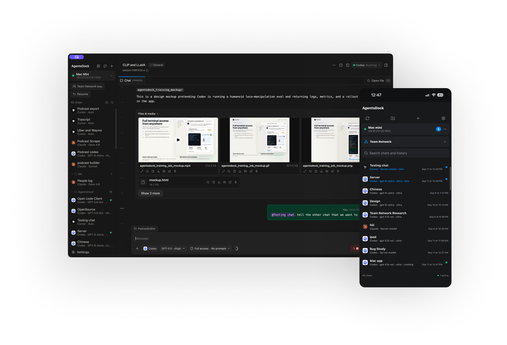

<h1 align="center">AgentsDock: an IDE designed for agentic AI research</h1>

<div align="center">
  <a href="https://agentsdock.net">
    
  </a>
  <a href="https://github.com/ZhengyiLuo/AgentsDock/releases/latest">
    
  </a>
  <a href="https://discord.gg/ZGDrhEWqPt">
    
  </a>
  
  <a href="CONTRIBUTING.md">
    
  </a>
</div>

<p align="center">
  <a href="https://agentsdock.net">
    
  </a>
</p>

<div align="center">
  AgentsDock brings <strong>Claude Code</strong>, <strong>Codex</strong>,
  <strong>Cursor</strong>, and <strong>OpenCode</strong> into one desktop and
  mobile workspace for coding and research.
  <strong>Gemini</strong> is also supported on desktop through an API connection
  in versions containing the Gemini integration.
  <br />
  <br />
  <strong>Desktop:</strong>
  <a href="https://github.com/ZhengyiLuo/AgentsDock/releases/latest">Download for macOS, Windows or Linux — latest stable</a>
  ·
  <a href="https://github.com/ZhengyiLuo/AgentsDock/releases">All releases and release notes</a>
  <br />
  <strong>Mobile:</strong>
  <a href="https://apps.apple.com/us/app/agentsdock/id6769275751">iPhone &amp; iPad</a>
  ·
  <a href="https://github.com/ZhengyiLuo/AgentsDock-Releases/releases/download/android-v0.1.1-beta.9/AgentsDock-0.1.1-android-arm64-beta.9.apk">Android</a>
  <br />
  <br />
  <a href="https://agentsdock.net">Website</a>
  ·
  <a href="https://agentsdock.net/setup.html">Setup guide</a>
  ·
  <a href="https://agentsdock.net/features.html">Features</a>
</div>

## What you can do

- Work with multiple agents and servers in one place.
- Review code, plots, images, and videos right in your chats.
- Browse files, use terminals, and schedule jobs.
- Continue your work from desktop or mobile.

See the [website](https://agentsdock.net) for screenshots and
[feature walkthroughs](https://agentsdock.net/features.html).

## How it works

**AgentsServer** runs your agents on a computer you control.
**AgentsDock** connects to it from your desktop or phone. The server and desktop
app can run on the same computer.

## Get started

1. **Prepare your computer.** Use Linux or an Apple silicon Mac with
   Node.js **22.14+**, `uv`, and `tmux`.
   [Prerequisite instructions →](server/README.md#1-prepare-the-server-machine)
2. **Install the server.** Run on that computer, without `sudo`:

   ```sh
   npm install -g agentsdock
   ```

   First installation automatically sets up and starts the server.
3. **Connect the app.** [Download AgentsDock](https://agentsdock.net/#downloads).
   Run `agentsdock list` and `agentsdock token default` on the server, then add
   its URL and token in the app. For another device, use the listed LAN or
   Tailscale address.
4. **Start chatting.** Install and sign in to your preferred agent CLI on the
   server, then choose an agent and workspace in the app.

Follow the [full setup guide](https://agentsdock.net/setup.html) for connection
help. Already have a server? npm leaves it unchanged; update through
**Settings → Updates** in the desktop app.

## Develop from source

Use Git, **Node.js 24**, and **pnpm 11.9.0** (the version pinned by the project).
Desktop and mobile are separate packages; install dependencies in the package
you are working on. You also need a running AgentsServer to use the app.

```bash
git clone https://github.com/ZhengyiLuo/AgentsDock.git
cd AgentsDock
```

### Desktop

The current desktop app is built with Electron, React, and TypeScript. From
the repository root:

```bash
cd electron
pnpm install --frozen-lockfile
pnpm typecheck
pnpm test
pnpm dev
```

`pnpm build` compiles the app without packaging or publishing it. For desktop
architecture and platform-specific packaging, see
[electron/README.md](electron/README.md).

### Mobile: iPhone, iPad, and Android source

The current iPhone/iPad app lives in **`mobile-react/`**, using React Native
and Expo. Android source and native modules live in that same package. From
the repository root:

```bash
cd mobile-react
pnpm install --frozen-lockfile
pnpm typecheck
pnpm test:history
pnpm test:server-setup
```

For local iOS development on macOS with Xcode, continue in `mobile-react/`:

```bash
pnpm exec expo prebuild --platform ios
pnpm exec expo run:ios
```

Use a simulator or your own signing configuration. Read the
[mobile development guide](mobile-react/README.md) before installing on a
device: using the existing bundle identifier can replace your installed app.
Android development requires the Android toolchain.

## Where things live

| Directory | Purpose |
| --- | --- |
| [`electron/`](electron/) | Current desktop client for macOS, Linux, and Windows |
| [`mobile-react/`](mobile-react/) | Current React Native mobile client, including native modules in `modules/` |
| [`website/`](website/) | Product website and user guides |
| [`team-hub/`](team-hub/) | Team Hub service code and tests |
| [`docs/`](docs/) | Architecture, development notes, and release-channel documentation |
| [`server/`](server/) | Maintained AgentsServer runtime, installer, and server-only tests |
| `Sources/`, `Apps/`, `ZenithDock.xcodeproj` | Legacy Swift clients, not the current Electron or React Native apps |

The maintained backend lives in `server/`. Its Python dependencies and installer
are self-contained; server users do not need to build either client. See
[the source migration notes](docs/SERVER_SOURCE_MIGRATION.md) before exporting
changes or preparing a coordinated release.

## Contributing

See [CONTRIBUTING.md](CONTRIBUTING.md) for checks and contribution guidelines.
Keep changes scoped and add regression tests where appropriate. Use synthetic
test data; do not commit credentials, private infrastructure details, chat
transcripts, or screenshots containing user data.

The repository's CI verifies source. It does not publish desktop releases,
upload mobile builds, or deploy servers. Official binaries and update feeds
are managed separately; see [release channels](docs/DIRECT_RELEASES.md).

## License

AgentsDock's original code is licensed under the [Apache License 2.0](LICENSE),
except where a component explicitly states another license. See [NOTICE](NOTICE)
for attribution and separately licensed components. Existing third-party
copyrights, licenses, and notices remain in effect.
